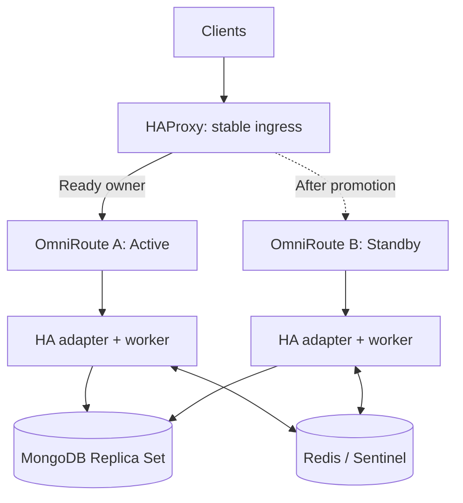

# OmniRoute HA

An Active-Passive high-availability extension for [OmniRoute](https://github.com/cheaper-inference/OmniRoute) featuring shared application state in MongoDB, automatic application failover, and fenced database writes. The version-pinned build overlay leaves the original upstream checkout unchanged.

**Status:** staging implementation, validated in a single-host environment. Independent multi-host deployment and production-scale qualification remain pending.

## Features

- SQLite-to-MongoDB compatibility layer for supported operations, with synchronous prepared-statement and transaction interfaces backed by a worker bridge.
- MongoDB-backed exclusive ownership lease, server-time evaluation, and monotonically increasing fencing epoch.
- Active-Passive operation with state reload before promotion and ownership checks within protected write transactions.
- Redis-based cache invalidation with support for Sentinel, direct/managed endpoints, and Cluster configuration.
- HAProxy readiness-based ingress, using `/readyz` to route traffic to the current owner without replaying requests.
- Pinned upstream build overlay, deployment tooling, regression tests, and acceptance procedures.

## Architecture



MongoDB holds durable application state and the exclusive ownership lease. On promotion, the epoch increases and the new owner reloads state before reporting readiness. Protected writes validate ownership in the same transaction; a former owner loses readiness and exits. Redis provides cache invalidation rather than the authoritative ownership decision.

The compatibility layer translates supported SQLite operations to MongoDB; unsupported operations fail closed. SQLite is used offline for schema generation, migration, and differential testing. The build overlays are applied to a separate build, not the upstream checkout.

## Compatibility

| Component | Version / role |
|---|---|
| OmniRoute | `v3.8.53` / `191dce8d534ceb56c28a08e71381284a9a87838f` |
| Node.js | `22.22.2` |
| Next.js | `16.4.5` (pinned in lockfile) |
| MongoDB | `8.0.16` tested; replica set |
| Redis | `7.2.17` tested |
| Platform | Ubuntu 22.04 tested; Ubuntu 24.04 deployment guide, target validation pending |

## Getting started

See [INSTALL.md](INSTALL.md) for exact prerequisites, the pinned runtime, infrastructure setup, and the full deployment and acceptance procedure. You can clone the repository or extract the release archive and begin from its project root. For a cloned checkout, skip the ZIP extraction step in the guide.

With the pinned Node.js runtime and other prerequisites prepared:

```sh
scripts/ha source
scripts/ha deps
scripts/ha build
bash scripts/verify-upstream.sh
```

Then configure MongoDB and Redis, prepare the two host environment files, run provisioning and preflight, start both application instances, and configure HAProxy as described in the guide. Never publish real environment files or secrets.

## Project layout

| Path | Purpose |
|---|---|
| `adapter/` | SQL translation, worker bridge, fencing, quota, Memory, and build overlays |
| `scripts/ha` | Source verification, dependency installation, build, provisioning, service, and acceptance commands |
| `scripts/` | Host launcher, deployment rendering, migration, and reconciliation tools |
| `deploy/` | Environment example, native test fixture, systemd and HAProxy templates |
| `tests/` | Regression and application acceptance tests |
| `upstream/omniroute/` | Official checkout created or supplied during installation (not tracked) |
| `.work/` | Generated build output, cache, and runtime data (not tracked) |

## Validation

The final staging package was reported to pass 258 regression checks and a single-host build and failover evaluation. A Combo configuration was preserved across application failover through the same HAProxy address, and the former owner returned as standby. The regression scope also includes Settings, API key revocation, MongoDB elections, Redis Sentinel reconnection, Memory retrieval, password and MFA authentication, bounded Chat and Responses quotas and streaming, selected OAuth flows, and BSON backup and restore.

See the acceptance procedure in [INSTALL.md](INSTALL.md) to reproduce the checks. The reported test count is a result of the original local evaluation, not a live CI badge or a new test run for this publication.

## Known limitations

- Independent application hosts, fresh Ubuntu 24.04 package installation, production load and site-specific TLS/ACL configuration still require validation.
- Full SQLite, provider, and quota-policy coverage is not claimed.
- A single HAProxy ingress remains a failure domain. Failover does not transfer already-open streams automatically.
- Fencing protects database writes; an external provider request already dispatched can still take effect. Quota liabilities with unknown outcomes remain reserved until reconciliation.

## Contributing

Reproducible bug reports, compatibility findings, tests, and documentation improvements are welcome. See [CONTRIBUTING.md](CONTRIBUTING.md).

## License and upstream

Licensed under the [MIT License](LICENSE). Upstream credit and third-party notices are provided in [THIRD_PARTY_NOTICES.md](THIRD_PARTY_NOTICES.md). This is an independent extension for OmniRoute, not an official OmniRoute distribution.
