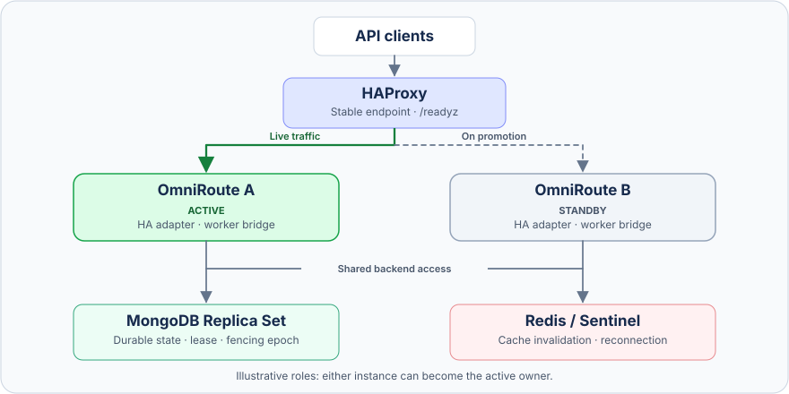

# OmniRoute HA


[](LICENSE)

High-availability extension for [OmniRoute](https://github.com/cheaper-inference/OmniRoute) that replaces supported runtime SQLite operations with shared MongoDB persistence, enabling automatic application failover without modifying the original upstream checkout.

## Features

- **Active-Passive failover** with automatic promotion and readiness-based routing.
- **SQLite-to-MongoDB adapter** with synchronous statement and transaction interfaces.
- **Ownership and fencing** to prevent stale-owner database writes.
- **Redis Sentinel** for resilient cache invalidation.
- **Build overlay and deployment tooling** for reproducible installation.

## Architecture

<p align="center">
  
</p>

HAProxy routes requests to the ready owner. Both instances share MongoDB and Redis; MongoDB controls ownership and durable state, while Redis handles cache invalidation.

## Quick start

On Linux x86-64, with the required runtime and prerequisites from [INSTALL.md](INSTALL.md):

```bash
git clone https://github.com/SEPEHRZSH/omniroute-ha.git
cd omniroute-ha
scripts/ha source
scripts/ha deps
scripts/ha build
```

See the **[installation and deployment guide](INSTALL.md)** for MongoDB, Redis, HAProxy, service configuration and acceptance tests.

## Project layout

```text
adapter/   # Database adapter, fencing and build overlay
deploy/    # HAProxy, systemd and environment templates
scripts/   # Build, provisioning and deployment tooling
tests/     # Regression and failover tests
docs/      # Architecture diagram
```

## Validation

Tested with OmniRoute **v3.8.53**, Node.js **22.22.2**, MongoDB **8.0.16**, Redis **7.2.17** and Ubuntu **22.04**. The original single-host staging evaluation reported **258 regression checks passed**, including application failover, Combo persistence and database/cache recovery. Independent multi-host and production-scale validation remain pending.

## License

[MIT](LICENSE) · Independent extension for [OmniRoute](https://github.com/cheaper-inference/OmniRoute).
