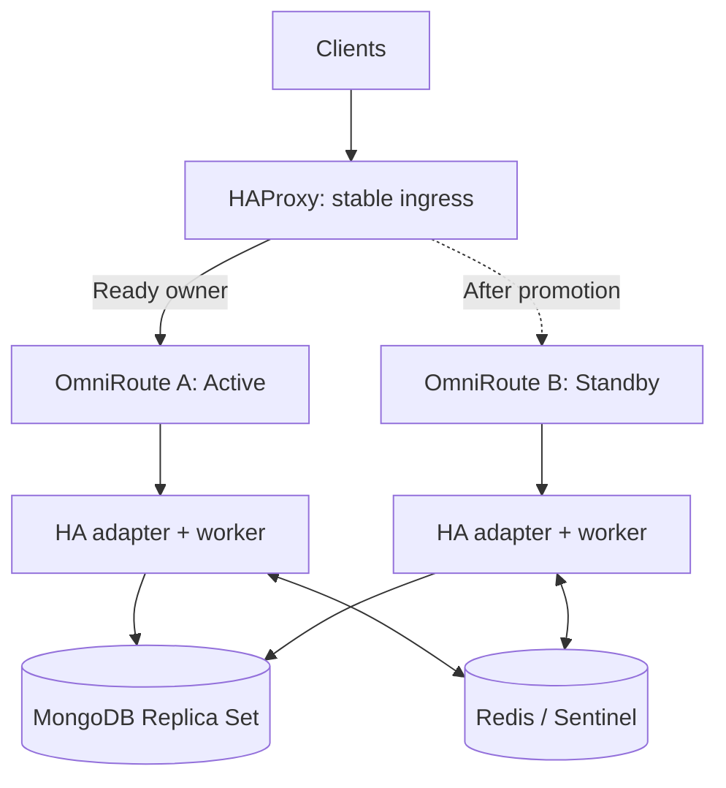

# OmniRoute HA

**High availability for OmniRoute, without modifying its upstream checkout.**

An independent Active-Passive extension with shared MongoDB state, a SQLite-to-MongoDB compatibility layer, fenced ownership, Redis Sentinel support, and HAProxy ingress.

> **Status:** Staging implementation. Single-host validation completed; independent multi-host and production-scale validation pending. Source and installation guide are being imported into this repository; the project is not yet installable from this checkout.

## Why OmniRoute HA?

An embedded SQLite database and process-local state make application failover difficult. This project adds a version-pinned build overlay and a database compatibility layer so two instances can share durable state while only the current owner serves traffic.

## Architecture

MongoDB provides durable state and authoritative ownership. Promotion increments the fencing epoch and reloads state before readiness. Protected writes check ownership within the transaction. Redis supports cache invalidation, not the authoritative ownership decision. HAProxy routes to the ready owner through `/readyz`.

## Features

- SQLite-to-MongoDB compatibility for supported operations, with a synchronous worker bridge.
- Exclusive ownership lease and monotonically increasing fencing epoch.
- Active-Passive application failover and readiness-based traffic routing.
- Redis Sentinel support and cache invalidation.
- Reproducible, version-pinned build overlay.
- Deployment tooling and regression/acceptance tests.

## Compatibility and validation

| Component | Version / role |
|---|---|
| OmniRoute | v3.8.53 |
| Node.js | 22.22.2 |
| MongoDB | 8.0.16 tested; replica set |
| Redis | 7.2.17 tested |
| Platform | Ubuntu 22.04 tested; Ubuntu 24.04 target validation pending |

The original local staging evaluation reported 258 successful regression checks and preservation of Combo configuration across failover through the same HAProxy address. These are reported local results, not a CI badge or a new run on GitHub.

## Limitations

Full SQLite compatibility and production readiness are not claimed. A single HAProxy is a failure domain; already-open streams are not transferred automatically. Independent multi-host deployment, production load and site-specific TLS/ACL configuration require further validation.

## Contributing

Reproducible bug reports, compatibility findings, tests, and documentation improvements are welcome. See [CONTRIBUTING.md](CONTRIBUTING.md).

## License

[MIT](LICENSE). An independent extension for [OmniRoute](https://github.com/cheaper-inference/OmniRoute), not an official upstream release.
